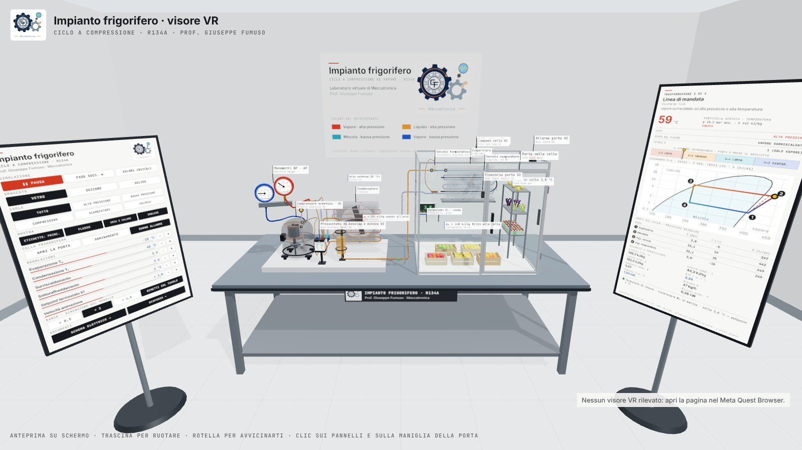

# Impianto frigorifero · Ciclo a compressione — simulatore per visore VR

Simulatore didattico in realtà virtuale di un **impianto frigorifero a R134a** con la sua **cella frigorifera**, da usare con il visore **Meta Quest 2 / 3 / 3S**. Il circuito comprende compressore ermetico, condensatore ad aria, valvola di espansione termostatica ed evaporatore; il refrigerante scorre colorato secondo il suo stato e i valori di pressione, temperatura ed entalpia vengono dal modello termodinamico della dispensa.

**Prof. Giuseppe Fumuso** — Meccatronica

▶ **Apri il simulatore:** https://homeassistant500-png.github.io/Impianto-frigorifero-vr/

📘 **Dispensa per lo studio:** https://homeassistant500-png.github.io/Impianto-frigorifero-vr/dispensa-impianti-frigoriferi.html

🖥️ **Simulatore 3D per PC e LIM:** https://homeassistant500-png.github.io/Impianto-frigorifero-vr/Impianto-frigorifero-simulatore-3D.html

---

## Cosa si può fare

- Vedere l'impianto appoggiato sul **banco del laboratorio virtuale**, prenderlo in mano, girarlo e cambiarne la dimensione (× 0,5 · × 1 · × 1,5, oppure con la levetta).
- Seguire il **giro del refrigerante** nelle quattro trasformazioni: compressione 1 → 2, condensazione 2 → 3, laminazione 3 → 4, evaporazione 4 → 1. Una **particella gialla** viene seguita lungo il circuito e il pannello dei dati ne mostra temperatura, pressione, entalpia, stato e titolo.
- Osservare i **colori del refrigerante**: rosso vapore ad alta pressione, arancione liquido ad alta pressione, azzurro miscela a bassa pressione, blu vapore a bassa pressione; le gocce di liquido e le bolle di vapore scorrono nei tubi.
- Aprire l'impianto con lo **spaccato**: vetro, sezione, solido (nel compressore si vedono motore, manovella, biella e pistone).
- **Isolare** il lato di alta pressione, il lato di bassa pressione, il compressore, gli scambiatori o la valvola.
- Vedere l'**aria** che attraversa condensatore ed evaporatore e il **calore** scambiato (q꜀ ceduto all'aria, q₀ tolto alla cella).
- Osservare il **pressostato combinato di massima e minima B2**, simile a un Danfoss KP15, montato accanto al compressore: scale LP e HP con gli indici di taratura, perni di taratura e pulsante **RESET** sopra, soffietti sotto. Due tubi in rame da 1/4", ortogonali come il resto del circuito, lo collegano alla linea di mandata (P>, alta pressione) e alla linea di aspirazione (P<, bassa pressione). Quando P> interviene il pulsante RESET sporge e lampeggia: si riarma puntandolo con il grilletto (su PC con un clic).
- **Prendere la frutta**: a porta della cella aperta, avvicina la mano a una mela (rossa o verde) e stringi l'impugnatura per prenderla. Portala alla bocca per darle un morso (si vede il segno con la polpa, si sente il rumore e il controller vibra). Lasciala vicino al suo posto e torna nella cassetta; lasciata altrove cade sul banco o sul pavimento e si può riprendere.
- Lavorare sulla **cella frigorifera**: aprire la porta con il grilletto sulla maniglia (lampada H1, ventola M3 ferma, allarme H2 dopo 10 s), avviare lo **sbrinamento**, leggere il termostato S1 e i manometri di bassa e alta pressione.
- Cambiare le **regolazioni** con i pulsanti − e +: temperatura di evaporazione e di condensazione, surriscaldamento, sottoraffreddamento, setpoint del termostato, velocità dell'animazione. Diagramma p–h, punti del ciclo, COP e potenze si aggiornano subito.
- Mostrare le **etichette** sui componenti (principali o tutte) e i **termini in inglese**.
- Aprire lo **schema elettrico funzionale** della cella direttamente nel visore: i conduttori in tensione si colorano in tempo reale e si possono simulare l'intervento del pressostato di massima, l'apertura del pressostato di minima, il riarmo e lo sbrinamento.
- Studiare la **dispensa nel visore**: il pulsante **DISPENSA** apre un pannello con la **teoria** (sezioni 1.1–1.7 a pagine, con il diagramma p–h di R134a) e un **quiz** di 10 domande con correzione immediata.

## Comandi dei controller

| Comando | Azione |
|---|---|
| **Grilletto** | Preme i pulsanti dei pannelli; sulla striscia del ciclo sposta la particella seguita; sulla maniglia apre e chiude la porta della cella; sul pulsante del pressostato B2 riarma P> |
| **Impugnatura** (tasto laterale) | Afferra l'impianto per spostarlo e girarlo; vicino a una mela, a porta aperta, prende la mela |
| **Levetta destra** ← → | Ruota l'impianto |
| **Levetta destra** ↑ ↓ | Ingrandisce o rimpicciolisce l'impianto |
| **Levetta sinistra** ← → | Sposta la particella seguita avanti o indietro nel circuito |
| **Levetta sinistra** ↑ ↓ | Velocità dell'animazione |
| **A** | Pausa / avvia |
| **B** | Trasformazione successiva |
| **X** | Spaccato successivo (vetro → sezione → solido) |
| **Y** | Isolamento successivo |

Il pulsante **RIMETTI SUL TAVOLO** del pannello riporta l'impianto sul banco, nella posizione iniziale; **ADATTA ALTEZZA** corregge l'altezza dello sguardo (utile anche da seduti).

## Come si apre il simulatore per visore

1. **Prima di indossare il visore**, mettiti in piedi in uno spazio libero. Se il Quest lo chiede, imposta il **confine in modalità «Spazio» (in piedi)** e conferma l'altezza del pavimento. Evita la modalità «Stazionario/seduto»: con quella la pagina non conosce l'altezza del pavimento.
2. Apri **Meta Quest Browser** e digita l'indirizzo **esattamente con la I maiuscola**: `https://homeassistant500-png.github.io/Impianto-frigorifero-vr/`. Salvalo nei preferiti.
3. Guarda dritto davanti a te e **tieni premuto il pulsante Meta** (il tasto con il logo, sul controller destro) per ricentrare la vista.
4. Premi il pulsante rosso **ENTRA NEL VISORE** e consenti l'accesso alla realtà virtuale.
5. Se banco e impianto ti sembrano troppo grandi o troppo in alto, premi **ADATTA ALTEZZA** nel pannello dei comandi a sinistra: lo sguardo viene portato all'altezza di una persona in piedi (1,62 m). La pagina lo fa da sola quando il visore non fornisce il pavimento. Se il banco è di lato o lontano, tieni premuto di nuovo il pulsante Meta per ricentrare.

Ti trovi in piedi davanti al banco: a sinistra il **pannello dei comandi**, a destra il **pannello dei dati**, sulla parete il poster con i colori del refrigerante. Lo schema elettrico e la dispensa si aprono in un pannello più grande, davanti a destra sopra la cella, sempre in primo piano; si chiude con **✕ CHIUDI**.

La pagina funziona solo da un indirizzo **https** (come quello di GitHub Pages): aperta come file dal disco o da un indirizzo http, il visore non entra in realtà virtuale.

Su PC o sulla LIM la stessa pagina si apre in **anteprima**: trascina per ruotare la vista, usa la rotellina per avvicinarti, clicca sui pannelli per usare i comandi e sulla maniglia per aprire la porta (tasti: spazio pausa, D porta). Per far vedere alla classe ciò che vede lo studente nel visore, usa la funzione **Trasmetti** del Quest verso la LIM o uno smartphone.

## Dispensa per lo studio

La dispensa interattiva **«Impianti frigoriferi»** si apre da PC, tablet o smartphone:

https://homeassistant500-png.github.io/Impianto-frigorifero-vr/dispensa-impianti-frigoriferi.html

Contiene quattro schede:

1. **Teoria** — che cosa fa un impianto frigorifero, i quattro componenti, calore sensibile e latente, diagramma entalpico, ciclo trasformazione per trasformazione, valvola termostatica, regolazione e sicurezze della cella.
2. **Simulatore del ciclo** — circuito animato, diagramma p–h in tempo reale e punti caratteristici.
3. **Cella frigorifera** — schema elettrico funzionale animato con comandi e guasti simulati, manometri R134a.
4. **Esercitazioni** — tabella di saturazione R134a ed esercizi su tre livelli.

È la versione per gli studenti: **non contiene le soluzioni** commentate degli esercizi.

Nel visore, il pulsante **APRI LA DISPENSA COMPLETA** esce dalla realtà virtuale e apre questa pagina nel browser del Quest; con «indietro» si torna al simulatore.

## Simulatore 3D per PC e LIM

La versione per lo schermo si apre da PC o dalla LIM, senza visore:

https://homeassistant500-png.github.io/Impianto-frigorifero-vr/Impianto-frigorifero-simulatore-3D.html

- Viste preimpostate: insieme, compressore, condensatore, valvola, evaporatore, cella.
- Spaccato, isolamento, flusso, aria e calore, etichette e termini in inglese.
- Pannelli in tempo reale: trasformazione, punti del ciclo, bilancio e prestazioni, diagramma p–h.
- Pressostato di massima e minima B2 (simile a un Danfoss KP15) con pulsante di riarmo cliccabile.
- Schema elettrico funzionale e dispensa interattiva incorporata.
- **Tour automatico:** se nessuno tocca la pagina il simulatore si presenta da solo.
- **Tasti:** spazio pausa · 1–6 viste · D porta · H nasconde i pannelli.

Il file funziona anche **senza Internet**: basta scaricare `Impianto-frigorifero-simulatore-3D.html` e aprirlo con un doppio clic sul PC della LIM.

## Dati tecnici e modello

**Refrigerante:** R134a. Pressioni e entalpie di saturazione da tabella (−40 ÷ +100 °C) con interpolazione; punto critico 101,1 °C e 40,59 bar. Tutte le pressioni dei calcoli sono **assolute**; manometri e pressostati leggono la **relativa** (p ass = p rel + 1,013 bar).

**Ciclo di partenza:** Tₑ = −10 °C, T꜀ = +40 °C, surriscaldamento 5 K, sottoraffreddamento 5 K.

| Grandezza | Valore usato |
|---|---|
| Compressore | alternativo ermetico, alesaggio 40 mm × corsa 27,5 mm*, 34,6 cm³, 2900 giri/min* → 6,0 m³/h |
| Rendimento isoentropico | 0,75 |
| Rendimento volumetrico | 1 − 0,05 (β − 1), limitato fra 0,3 e 1 |
| Termostato S1 | setpoint 2 °C, differenziale 2 K |
| Pressostato di massima P> | 18 bar relativi, riarmo manuale con il pulsante sul pressostato o dallo schema (si riarma sotto 14 bar) |
| Pressostato di minima P< | apre a 0,5 bar, richiude a 1,5 bar relativi |
| Allarme porta aperta | ritardo 10 s (temporizzatore KT1) |
| Termostato fine sbrinamento B3 | apre a +10 °C, richiude a +3 °C |
| Ventilatori | condensatore M2 1400 giri/min, evaporatore M3 1300 giri/min |

\* valori assunti.

**Semplificazioni didattiche:**

- cella frigorifera in scala ridotta, a pareti trasparenti, con frutta in cassette e sullo scaffale;
- dinamica della cella (temperatura, brina, pressioni ai manometri) qualitativa; lo sbrinamento dura 28 s per poterlo osservare in classe;
- animazione del compressore rallentata, quantità di fluido e velocità delle particelle non in scala;
- forme di carter, alette, ventole, valvola e ricevitori schematiche: le loro misure non compaiono nei pannelli.

## File del repository

| File | Contenuto |
|---|---|
| `index.html` | Il simulatore per visore in un unico file (circa 1,3 MB), senza collegamenti esterni |
| `Impianto-frigorifero-simulatore-3D.html` | Il simulatore 3D per PC e LIM in un unico file (circa 1,8 MB), con la dispensa incorporata, utilizzabile anche senza Internet |
| `dispensa-impianti-frigoriferi.html` | La dispensa interattiva per lo studio (versione per gli studenti, senza le soluzioni degli esercizi) |
| `logo.png`, `anteprima.jpg` | Logo e immagine di anteprima di questa pagina |
| `README.md` | Questa pagina |

Per aggiornare un file basta caricarne la nuova versione con lo stesso nome con **Add file → Upload files**: sostituisce la precedente e il sito si aggiorna in un paio di minuti.

## Materiali collegati

Fa parte della lezione sugli impianti frigoriferi insieme a:

- dispensa interattiva «Laboratorio Impianti Frigoriferi» (pubblicata qui la versione per gli studenti);
- simulatore 3D per la LIM (pubblicato qui);
- simulatore per visore (questa pagina).

Sullo stesso modello: [Honda GX160 · motore a 4 tempi per visore VR](https://homeassistant500-png.github.io/Gx160-vr/).

## Riconoscimenti

- Grafica 3D e realtà virtuale realizzate con [three.js](https://threejs.org) (licenza MIT) e WebXR.
- Diagramma p–h di R134a: DTU, Department of Energy Engineering (M.J. Skovrup e H.J.H. Knudsen).
- Caratteri Inter e JetBrains Mono (SIL Open Font License).

Materiale didattico del Prof. Giuseppe Fumuso · Meccatronica.
